

  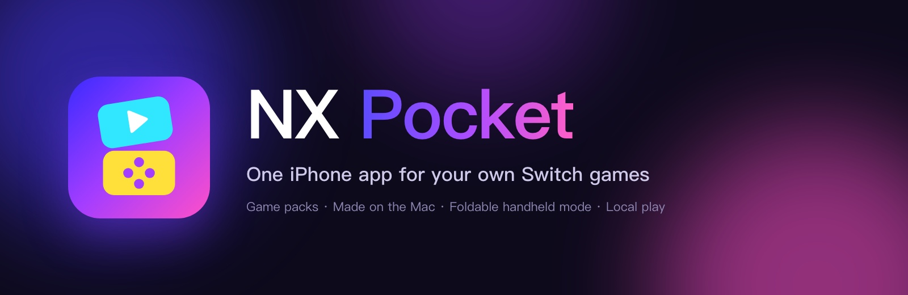

  
  
  
  
  

  <b>English</b> · <a href="README.zh-CN.md">简体中文</a>

  <b>One iPhone app for all your own Switch games.</b> 
  Not one app per game: a game library you fill with game packs, made on your Mac.

  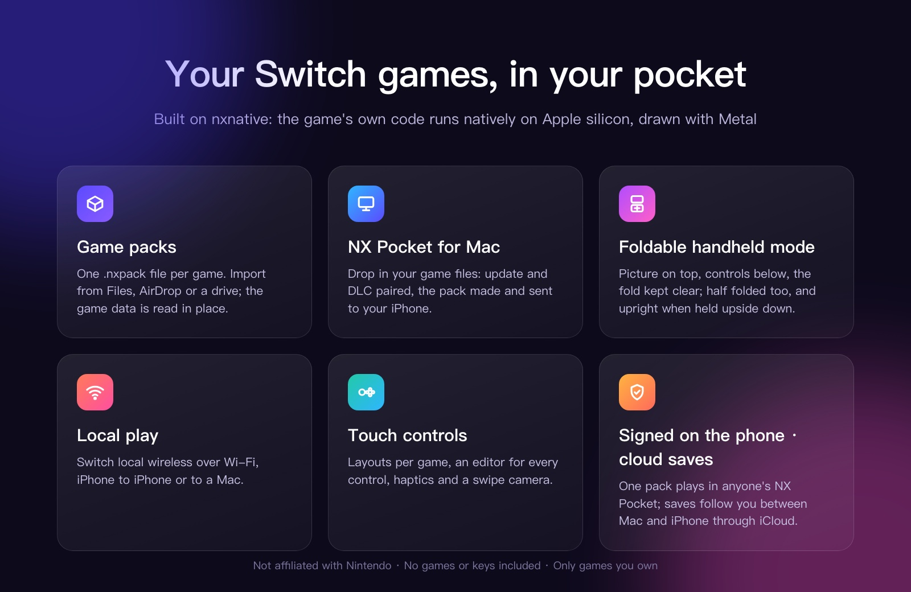

---

#### Highlights

- **Game packs.** Each game becomes one `.nxpack` file. Import it from Files, AirDrop or a drive; NX Pocket reads the game data in place and checks every part against its checksum.
- **Foldable handheld mode.** On a foldable iPhone the picture sits on the top half and the controls on the bottom, clear of the fold. Half folded, it stands like a handheld; held upside down, the picture turns itself upright.
- **Local play.** Switch local wireless over Wi-Fi between iPhones and Macs: Super Smash Bros. Ultimate and Mario Tennis Aces rooms, joining and matches.
- **NX Pocket for Mac.** Drop in your game files and get a pack, with live progress, a queue, one-click sending to your iPhone, and installing NX Pocket itself. **Play on Mac** runs the same game on the Mac, with keyboard, controllers and the same cloud saves. Switch 2 games come in as a dump folder or a NUP file.

## What NX Pocket is

NX Pocket is built on [nxnative](https://github.com/seedds/nxnative): the game's own code runs natively on the Apple chip, with Switch graphics rebuilt on Metal. NX Pocket adds the parts around it: an iPhone app that holds every game, a pack format to move games to it, a Mac app that makes the packs, and a layer for foldable phones.

<table>
  <tr>
    <td width="50%">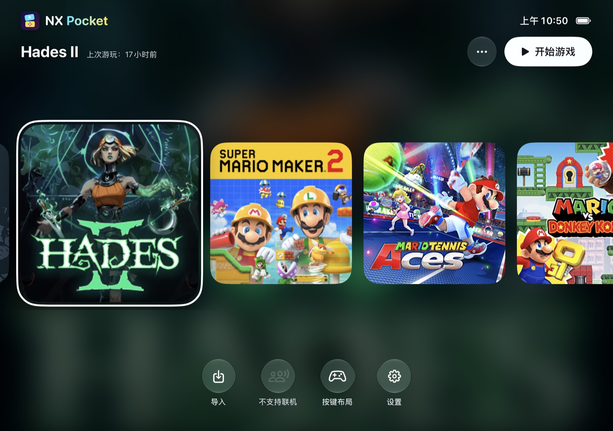 The game library</td>
    <td width="50%">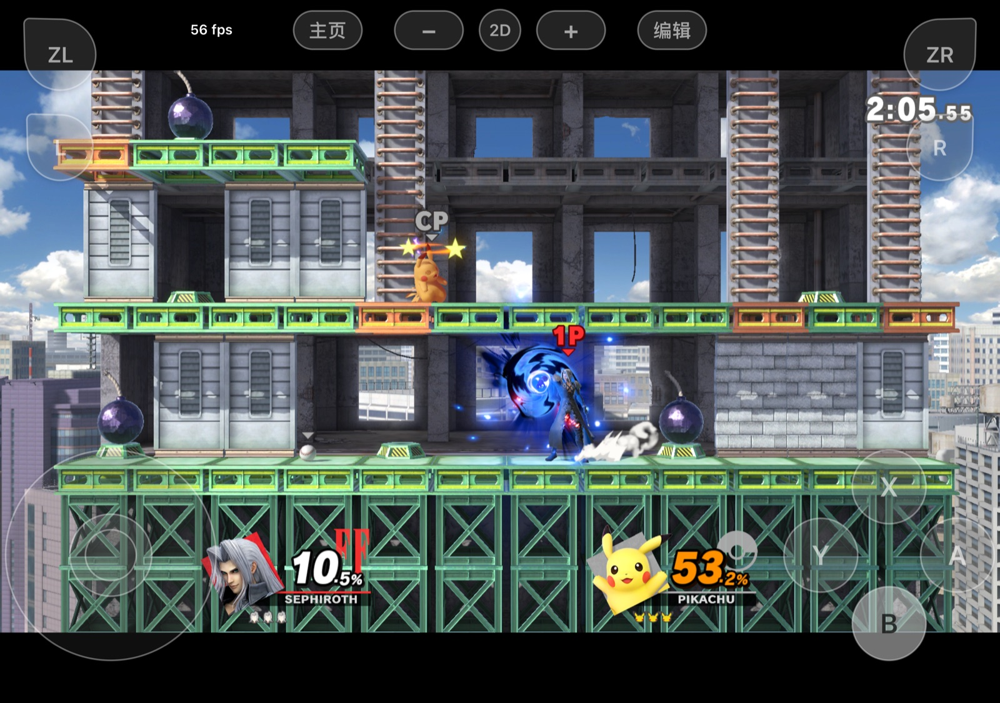 In a match, touch controls over the picture</td>
  </tr>
  <tr>
    <td width="50%" align="center">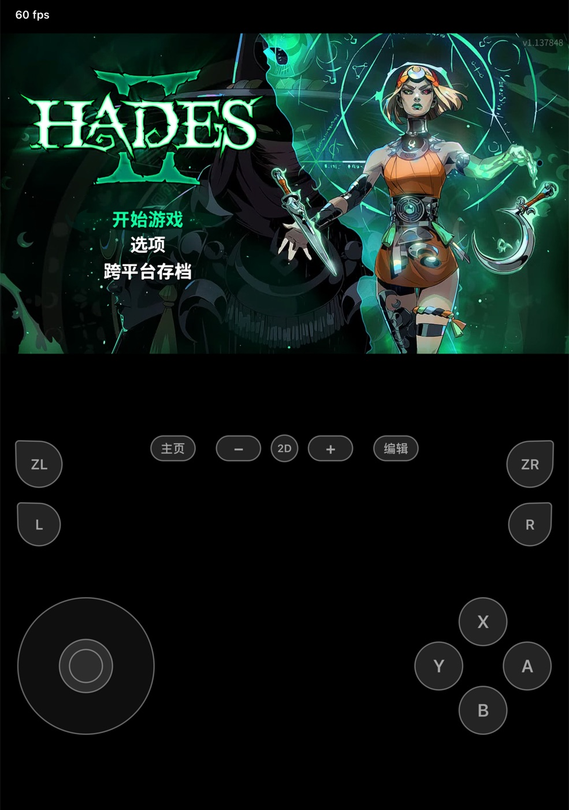 Handheld mode: picture on top, controls below</td>
    <td width="50%">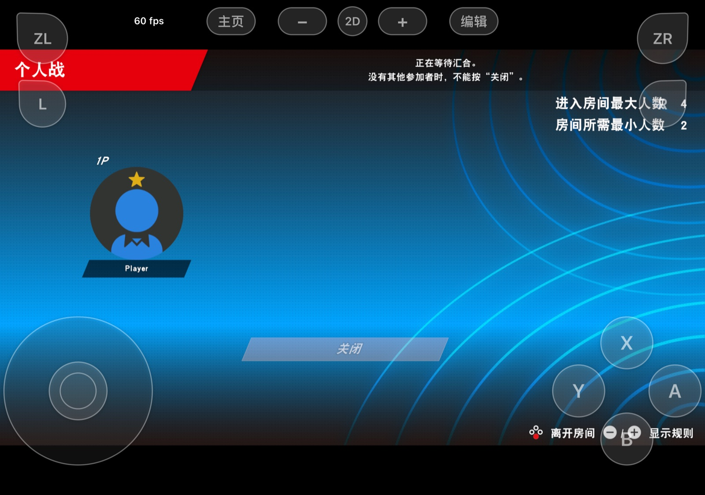 Local play: a room waiting for players</td>
  </tr>
</table>

## Requirements

- A Mac with Apple silicon, macOS 26.6 or later, and Xcode 27.2.
- An iPhone or iPad with an A17 Pro / M1 chip or later, iOS / iPadOS 26 or later.
- An Apple ID. A paid developer account is recommended: a year per signature, and the Increased Memory Limit entitlement the bigger games need.
- Your own game files (NSP, XCI, NSZ or XCZ) and your own `prod.keys`, dumped from your console.
- For a Switch 2 game: your own dump folder (`base/`, `updates/`, `dlc/`) or NUP file. These need no `prod.keys`.

## Install

1. **NX Pocket for Mac.** Download it from [Releases](https://github.com/zkkzkk/nx-pocket/releases/latest) and move it to Applications. It is not notarized: the first time, allow it in System Settings › Privacy & Security › Open Anyway.
2. **The code.** `git clone https://github.com/zkkzkk/nx-pocket.git` on a drive with room for your games' build files. Setup asks for this folder, checks Xcode and installs the build tools.
3. **A game.** Drop in its folder; NX Pocket for Mac pairs the base game, update and DLC and shows whether nxnative supports it. **Make Game Pack**: the first build of a game takes 10 to 60 minutes.
4. **NX Pocket on the iPhone.** Connect it (Developer Mode on) and click **Install NX Pocket**, or sideload the IPA from Releases. Then **Send to iPhone** or AirDrop the pack, and **Import Game Pack** in NX Pocket.

  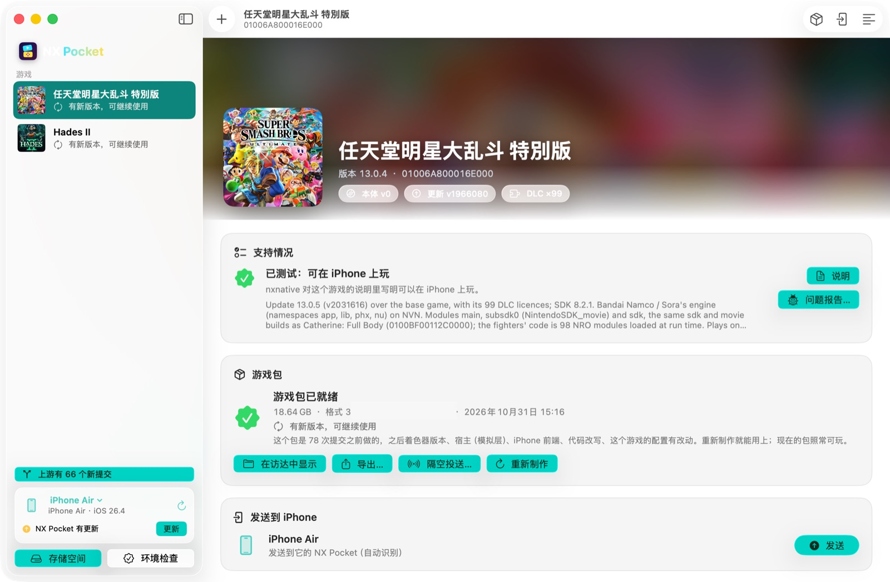

NX Pocket for Mac: nxnative's support for the game, its pack, and sending it to an iPhone.

## The iPhone app

- **Library.** Covers from each game's own icon, upscaled on the Mac; the background follows the selected game. Home pauses a game under the home screen; Resume picks it up.
- **Import.** From Files, AirDrop or a drive. **Use in Place** keeps a pack where it is; a copy can be cancelled. A pack cut off on the way is refused, naming the part.
- **Foldable handheld mode.** Layouts per posture (open landscape, open portrait, half folded, closed), the fold's real place from the system, and a self-turning picture when the system will not turn the app.
- **Touch controls.** Simple, full and per-game layouts (a Rhythm layout for Rhythm Heaven Groove), an editor for each control's size, place and opacity, haptics, D-pad diagonals, a swipe camera and a left stick anywhere on the left.
- **Signing on the phone.** Import a developer certificate and NX Pocket signs packs itself, so one pack plays in anyone's NX Pocket.
- **Cloud saves.** Saves follow you between NX Pocket for Mac and the iPhone through an iCloud Drive folder.
- **English and 简体中文**, with a language setting.

## Local play

Games whose profile turns it on play Switch local wireless over the Wi-Fi network, with ldn_mitm's LAN protocol: rooms, joining, matches. Each device gets its own player ID. Put both devices on the same Wi-Fi and allow local network access when asked.

| Game | Tested |
|---|---|
| Super Smash Bros. Ultimate | two Macs (the LAN test pair) |
| Mario Tennis Aces | two Macs through a full match; iPhone ↔ iPhone |

## Games

Any game nxnative supports can be made into a pack ([nxnative's games table](../dm/games/README.md#games)). Played with NX Pocket so far:

| | Game | Notes |
|---|---|---|
| 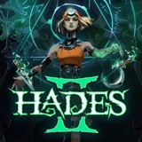 | **Hades II** | 60 fps on the iPhone; drawn at 1920×1080 |
| 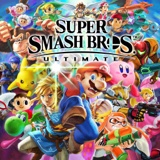 | **Super Smash Bros. Ultimate** | Local play; DLC fighters |
| 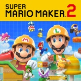 | **Super Mario Maker 2** | Open Course World (the community course server) |
|  | **Mario Tennis Aces** | Local play; adventure and matches |
| 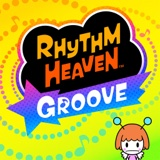 | **Rhythm Heaven Groove** | A Rhythm touch layout that follows each game |
| 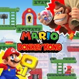 | **Mario vs. Donkey Kong** | nxnative's profile, packed as is |

## Limitations

- **Signing.** iOS runs a pack's code only when it is signed by the team that signed NX Pocket; free Apple IDs re-sign every 7 days.
- **Memory.** Large games need the Increased Memory Limit entitlement; some sideloading tools drop it.
- **A Mac is needed** to make packs: shaders are compiled with Xcode's Metal compiler.
- **Not notarized.** NX Pocket for Mac and the IPA are not signed with a Developer ID.

## For developers

- [The NX Pocket guide](../docs/nx-pocket/README.md): building packs, NX Pocket and NX Pocket for Mac from source.
- [Foldable phones](../docs/nx-pocket/foldable.md) · [Terms](../docs/nx-pocket/terms.md)
- [nxnative's README](../README.md), [agent and developer docs](../docs/agents/README.md).

## Credits

- [**nxnative**](https://github.com/seedds/nxnative) by seedds (MIT): the engine underneath.
- [**NX Play**](https://github.com/varyform/nx-native-wrapper) by varyform (MIT): parts of NX Pocket for Mac.
- Touch controls from nxnative pull requests #634, #433, #500, #258, #630 and #683; the Rhythm layout after [Touchable](https://github.com/MZhao-ouo/Touchable).
- Full list: [NOTICE](../NOTICE.md).

## Legal

**Not affiliated with Nintendo.** NX Pocket is not affiliated with, authorized or endorsed by Nintendo. Nintendo Switch is a trademark of Nintendo; game names and covers belong to their owners.

**No games, no keys.** NX Pocket provides no games, game files or keys. Use only games and console keys you legally own, and do not share game packs: a pack holds the whole game.
