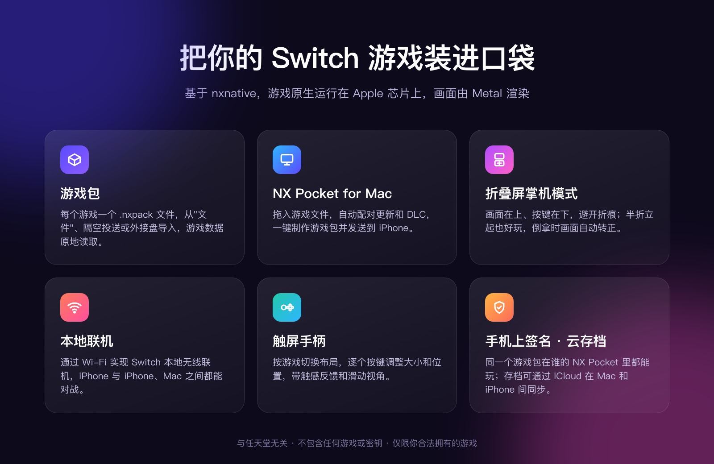
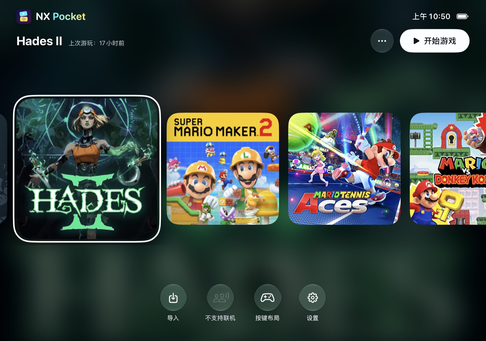
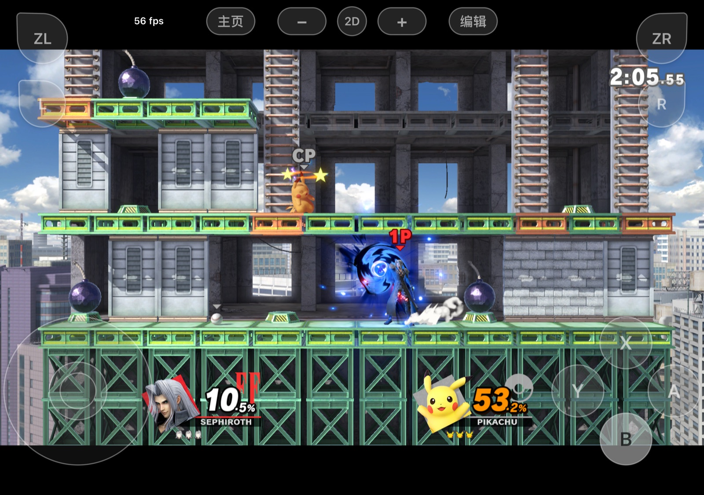
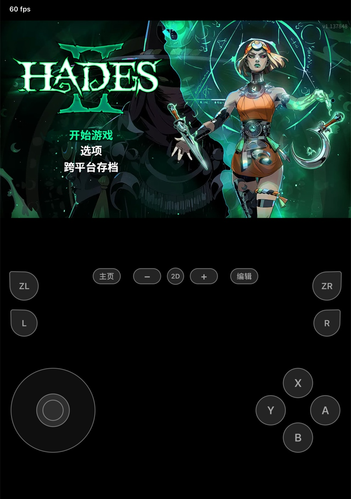
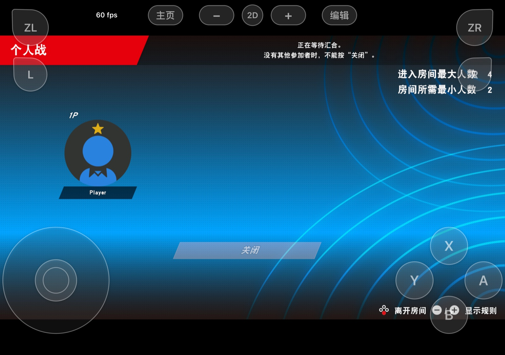
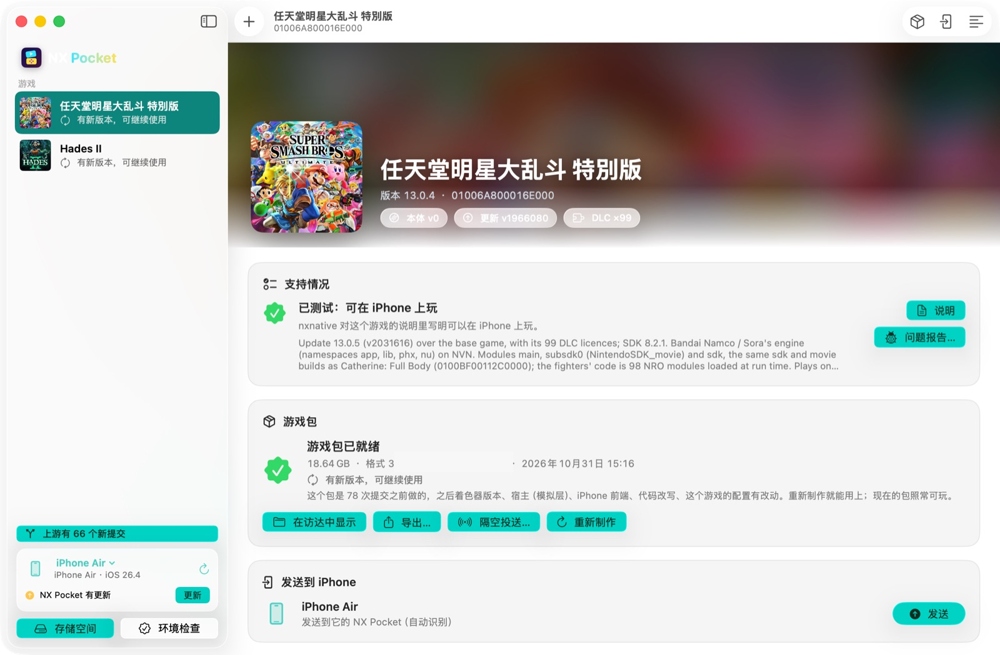
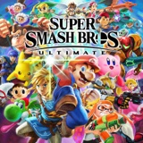
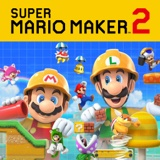

  

  
  
  
  
  

  <a href="README.md">English</a> · <b>简体中文</b>

  <b>一个 iPhone App，装下你自己的所有 Switch 游戏。</b> 
  不是一个游戏一个 App，而是一个游戏库：在 Mac 上把游戏做成游戏包，导进来就能玩。

  

---

#### 亮点

- **游戏包**：每个游戏就是一个 `.nxpack` 文件，从"文件"、隔空投送或外接盘导入。NX Pocket 原地读取游戏数据，并逐块核对校验值。
- **折叠屏掌机模式**：在折叠屏 iPhone 上，画面在上半屏、按键在下半屏，避开折痕；半折立起来就像一台掌机；倒着拿时画面会自己转正。
- **本地联机**：通过 Wi-Fi 实现 Switch 本地无线联机，iPhone 之间、iPhone 和 Mac 之间都能玩。任天堂明星大乱斗特别版、马力欧网球 Aces 已支持建房、加入和对战。
- **NX Pocket for Mac**：拖入游戏文件就能做出游戏包，有实时进度和排队制作，一键发送到 iPhone，还能直接把 NX Pocket 装到手机上。

## NX Pocket 是什么

NX Pocket 基于 [nxnative](https://github.com/seedds/nxnative)：游戏自己的代码原生运行在 Apple 芯片上，Switch 的画面用 Metal 重建。NX Pocket 补上了周边的部分：一个装下所有游戏的 iPhone App、一种把游戏搬到手机上的游戏包格式、一个制作游戏包的 Mac App，以及一层折叠屏适配。

<table>
  <tr>
    <td width="50%"> 游戏库</td>
    <td width="50%"> 对战中，触屏按键叠在画面上</td>
  </tr>
  <tr>
    <td width="50%" align="center"> 掌机模式：画面在上，按键在下</td>
    <td width="50%"> 本地联机：房间等待玩家加入</td>
  </tr>
</table>

## 需要准备

- 一台 Apple 芯片的 Mac，macOS 26.6 或更新，Xcode 27.1。
- A17 Pro / M1 或更新芯片的 iPhone 或 iPad，iOS / iPadOS 26 或更新。
- 一个 Apple ID。推荐付费开发者账号：签名一年有效，并且能开大型游戏需要的"大内存"权限。
- 你自己从主机导出的游戏文件（NSP、XCI、NSZ 或 XCZ）和 `prod.keys`。

## 安装

1. **NX Pocket for Mac**：从 [Releases](https://github.com/zkkzkk/nx-pocket/releases/latest) 下载，拖进"应用程序"。它没有经过公证，第一次打开后，到"系统设置 › 隐私与安全性"里点"仍要打开"。
2. **下载代码**：`git clone https://github.com/zkkzkk/nx-pocket.git`，放在空间够放游戏构建文件的盘上。首次引导会让你选这个文件夹，并检查 Xcode、安装制作工具。
3. **添加游戏**：把游戏文件夹拖进去，NX Pocket for Mac 会配对本体、更新和 DLC，并显示 nxnative 对它的支持情况。点**制作游戏包**，一个游戏第一次做要 10 到 60 分钟。
4. **在 iPhone 上安装 NX Pocket**：连上 Mac（打开开发者模式），点**安装 NX Pocket**，也可以侧载 Releases 里的 IPA。然后**发送到 iPhone** 或用隔空投送，在 NX Pocket 里**导入游戏包**。

  

NX Pocket for Mac：nxnative 对游戏的支持情况、游戏包状态，以及发送到 iPhone。

## iPhone App

- **游戏库**：封面用游戏自带的图标，在 Mac 上放大到高清；背景跟着选中的游戏变化。按"主页"会把游戏暂停在主页下面，"继续游戏"接着玩。
- **导入**：从"文件"、隔空投送或外接盘导入。"原地使用"不复制，复制也可以随时取消。传输不完整的包会被拒绝，并指出是哪一部分。
- **折叠屏掌机模式**：每种姿态（展开横屏、展开竖屏、半折、合上）都有对应布局；折痕位置由系统提供；系统不转的方向，App 自己把画面转过来。
- **触屏手柄**：简单、完整和按游戏定制的布局（节奏天国有专门的"节奏"布局）；每个按键的大小、位置、透明度都能单独调；触感反馈、十字键斜向、滑动视角，左摇杆可以在左半屏任意位置按下。
- **手机上签名**：导入开发者证书后，NX Pocket 会自己给游戏包签名，同一个包在谁的 NX Pocket 里都能玩。
- **云存档**：存档通过 iCloud 云盘文件夹在 NX Pocket for Mac 和 iPhone 之间同步。
- **中英双语**，设置里可以切换。

## 本地联机

游戏配置里打开了本地联机的游戏，可以通过 Wi-Fi 进行 Switch 本地无线联机（使用 ldn_mitm 的局域网协议）：建房、加入、对战。每台设备有自己的玩家 ID。两台设备连同一个 Wi-Fi，系统询问时允许访问本地网络即可。

| 游戏 | 已测试 |
|---|---|
| 任天堂明星大乱斗 特别版 | 两台 Mac（局域网对测） |
| 马力欧网球 Aces | 两台 Mac 打完整场；iPhone ↔ iPhone |

## 游戏

nxnative 支持的游戏都可以做成游戏包（见 [nxnative 的游戏列表](../dm/games/README.md#games)）。目前用 NX Pocket 玩过的：

| | 游戏 | 说明 |
|---|---|---|
|  | **哈迪斯 II** | iPhone 上 60 帧，1920×1080 渲染 |
|  | **任天堂明星大乱斗 特别版** | 本地联机；DLC 角色 |
|  | **超级马力欧创作家 2** | Open Course World（社区关卡服务器） |
|  | **马力欧网球 Aces** | 本地联机；冒险模式和比赛 |
|  | **节奏天国 奇迹之星** | 跟随每个小游戏变化的"节奏"触屏布局 |
|  | **马力欧 vs. 咚奇刚** | 直接使用 nxnative 的配置 |

## 已知限制

- **签名**：iOS 只运行和 NX Pocket 同一个团队签名的游戏代码；免费 Apple ID 每 7 天要重签一次。
- **内存**：大型游戏需要"大内存"权限，有些侧载工具会把它去掉。
- **需要一台 Mac** 来制作游戏包：着色器要用 Xcode 的 Metal 编译器编译。
- **未公证**：NX Pocket for Mac 和 IPA 都没有用 Developer ID 签名。

## 开发者

- [NX Pocket 使用与构建说明](../docs/nx-pocket/README.zh-CN.md)：从源码构建游戏包、NX Pocket 和 NX Pocket for Mac。
- [折叠屏设计](../docs/nx-pocket/foldable.zh-CN.md) · [中英术语表](../docs/nx-pocket/terms.md)
- [nxnative 的说明](../README.md)、[开发文档](../docs/agents/README.md)。

## 致谢

- [**nxnative**](https://github.com/seedds/nxnative)，作者 seedds（MIT）：底层引擎。
- [**NX Play**](https://github.com/varyform/nx-native-wrapper)，作者 varyform（MIT）：NX Pocket for Mac 的部分代码。
- 触屏手柄来自 nxnative 的 PR #634、#433、#500、#258、#630、#683；"节奏"布局参考了 [Touchable](https://github.com/MZhao-ouo/Touchable) 的设计。
- 完整列表见 [NOTICE](../NOTICE.md)。

## 法律声明

**与任天堂无关**：本项目与任天堂无关，未获任天堂授权或认可。Nintendo Switch 是任天堂的商标，游戏名称和封面归各自的权利人所有。

**不提供游戏和密钥**：NX Pocket 不提供任何游戏、游戏文件或密钥。请仅使用你自己合法拥有的游戏和主机密钥，也请勿分享游戏包：一个游戏包里就是完整的游戏。
