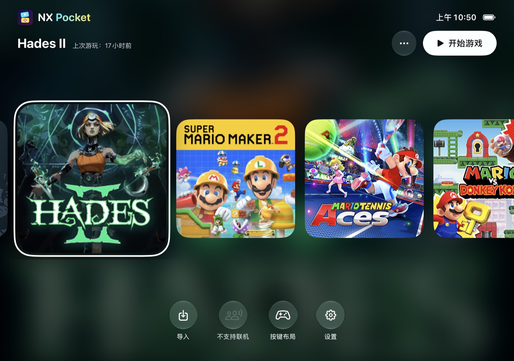
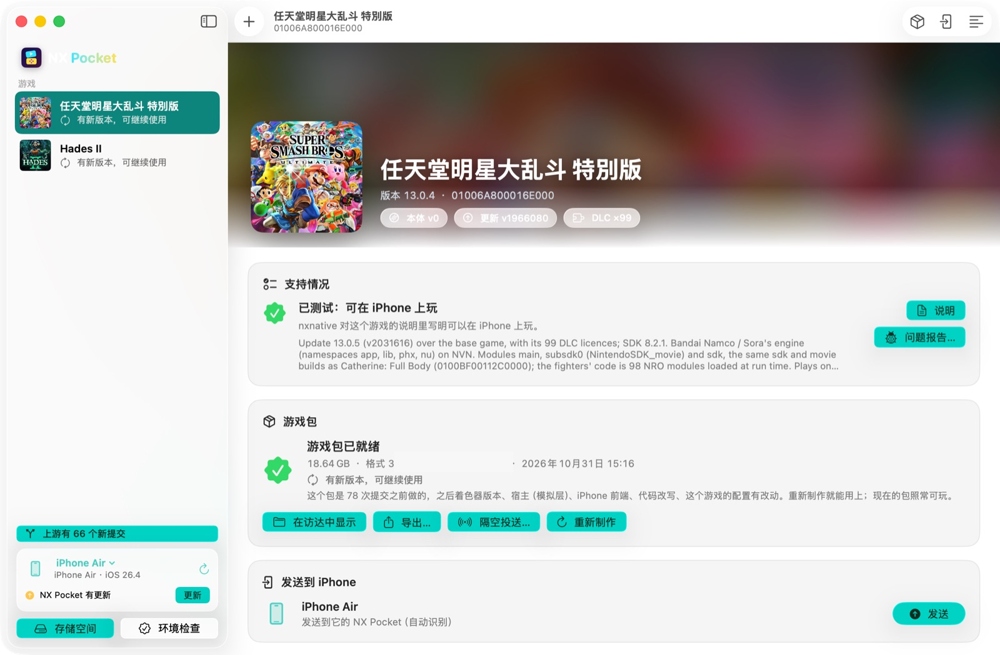

# NX Pocket

[简体中文](README.zh-CN.md)

NX Pocket is one iPhone app for all your Switch games, built on [nxnative](https://github.com/seedds/nxnative). Instead of one app per game, each game becomes a **game pack** (one `.nxpack` file) that you import into NX Pocket. NX Pocket for Mac makes the packs from your own game files and sends them to your iPhone.

> **Disclaimer.** NX Pocket is not affiliated with, authorized or endorsed by Nintendo. Nintendo Switch is a trademark of Nintendo. NX Pocket provides no games or keys: use only games and console keys you legally own. Do not share game packs: a pack holds the whole game.

 

NX Pocket on a foldable iPhone (left) and NX Pocket for Mac (right).

## What it does

- **One app, a library of games.** Import game packs from Files, AirDrop or a drive; the home screen shows each game's cover with a blurred background.
- **Game packs.** A pack is one file: the game's code built as a library, its shaders, its data (read in place, never unpacked twice) and a checksum table. A copy cut off or damaged on the way is refused, naming the part.
- **Signing on the iPhone.** iOS loads only code signed by the team that signed the app. NX Pocket can sign a pack on the phone with a developer certificate you import, so one pack plays in anyone's NX Pocket.
- **Foldable phones.** On a foldable iPhone the picture and the controls follow the posture (open, half folded, closed), the controls stay off the fold, and the picture turns itself when the phone is held upside down ([details](foldable.md)).
- **Local play.** Switch local wireless over the Wi-Fi network between phones (and Macs), for games whose profile turns it on (Super Smash Bros. Ultimate, Mario Tennis Aces).
- **NX Pocket for Mac.** Adds your game files (base game, update and DLC paired automatically), shows whether nxnative supports the game, makes the pack with live stages and time left, queues several games, sends packs over the cable or AirDrop, installs NX Pocket on the iPhone, and cleans up build files.

## What you need

- A Mac with Apple silicon, macOS 26.6 or later, and Xcode 27.2 (see [nxnative's README](../../README.md#build-from-the-command-line) for the toolchain).
- An iPhone or iPad that nxnative supports (A17 Pro / M1 or later), iOS / iPadOS 26 or later.
- An Apple ID. A paid developer account is recommended: its signatures last a year and it allows the Increased Memory Limit entitlement, which the bigger games need. A free account's signatures last 7 days.
- Your own game files (NSP / XCI / NSZ / XCZ) and your own `prod.keys`, dumped from your console.

## Getting started

1. **NX Pocket for Mac.** Download the Mac app (zip) from Releases and move the app to Applications. It is not notarized: the first time, open it, then allow it in System Settings → Privacy & Security → Open Anyway. Or build it yourself: `dm/mac/pocket/build.sh <output folder>`.
2. **Get the code.** Packs are made by this repository's scripts, so NX Pocket for Mac needs a copy of it: `git clone https://github.com/zkkzkk/nx-pocket.git` (on a drive with room for your games' build files). Setup asks for this folder.
3. **Setup.** The first start checks Xcode and installs what a build needs (Homebrew tools, Python modules). Point it at your `prod.keys`; only the path is kept, the keys are never copied.
4. **Add a game.** Drag in the folder with the game's files. The app pairs the base game, its update and DLC, and tells you whether nxnative supports it (tested / in progress / no profile).
5. **Make Game Pack.** The first build of a game takes 10 to 60 minutes (most of it compiling shaders); later builds reuse the build files. Packs go to the game pack folder set in Settings.
6. **Install NX Pocket.** With the iPhone connected (Developer Mode on), click Install NX Pocket; the app builds it with your team and installs it. Or sideload the IPA from Releases with AltStore or a similar tool (Sideloadly drops the Increased Memory Limit entitlement).
7. **Send to iPhone**, or AirDrop the pack, then **Import Game Pack** in NX Pocket. Choose **Use in Place** for a pack already on the phone. The first start of a game prepares its shaders once.

## Signing

| Who signs NX Pocket | Who signs the packs | Notes |
|---|---|---|
| Your team | Your team, on the Mac | The default. Friends' iPhones must be in your account's device list. |
| Anyone (e.g. a friend's own Apple ID, through a sideloading tool) | NX Pocket on the phone | Import the developer certificate (`.p12`) of the team that signed NX Pocket in Settings; packs are signed when they are imported. |

## Building from source

- Game packs: `dm/ios/tools/build_pack.py --xcode <game's Xcode project> --output <file>.nxpack --format 3` (the game's project comes from `scripts/build_ipa_from_nsp.py --prepare-xcode`).
- NX Pocket: `dm/ios/tools/build_pocket.py --team <team ID> --bundle-id <ID> --output <folder> [--device <UDID>]`.
- NX Pocket for Mac: `dm/mac/pocket/build.sh <folder>`.
- Words used in the apps and these documents: [terms](terms.md).

## Credits

NX Pocket is built on [nxnative](https://github.com/seedds/nxnative) by seedds (MIT). NX Pocket for Mac adapts parts of [NX Play](https://github.com/varyform/nx-native-wrapper) by varyform (MIT). See [NOTICE](../../NOTICE.md).
