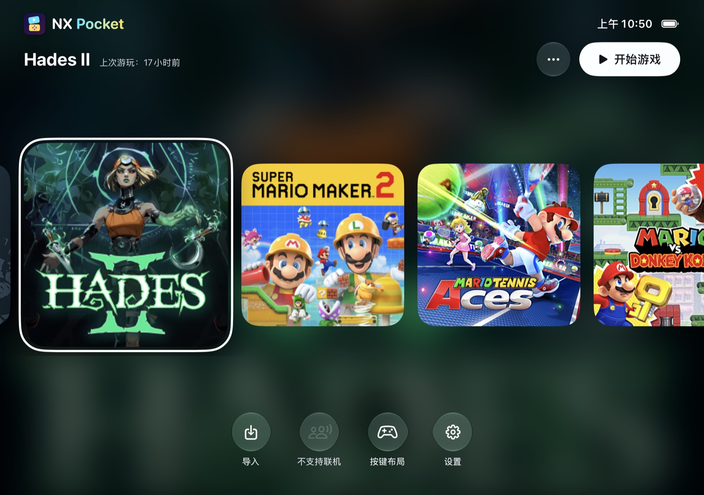
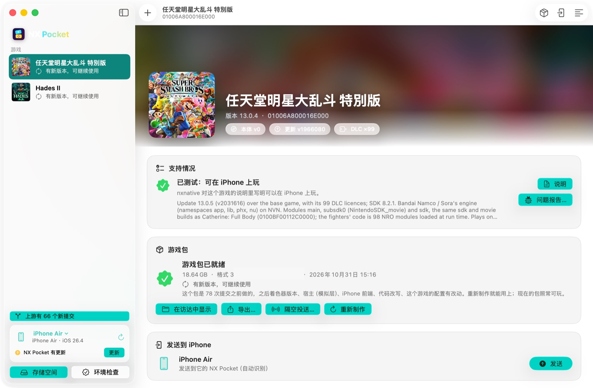

# NX Pocket

[English](README.md)

NX Pocket 是一个在 iPhone 上装所有 Switch 游戏的 App，基于 [nxnative](https://github.com/seedds/nxnative)。它不是一个游戏一个 App，而是把每个游戏做成一个**游戏包**（一个 `.nxpack` 文件），导入 NX Pocket 就能玩。NX Pocket for Mac 用你自己的游戏文件制作游戏包，再发送到 iPhone。

> **免责声明**：本项目与任天堂无关，未获任天堂授权或认可。Nintendo Switch 是任天堂的商标。NX Pocket 不提供任何游戏或密钥，请仅使用你自己合法拥有的游戏和主机密钥。请勿分享游戏包：一个游戏包里就是完整的游戏。

 

左：折叠屏 iPhone 上的 NX Pocket；右：NX Pocket for Mac。

## 功能

- **一个 App，一个游戏库**：从"文件"、隔空投送或外接盘导入游戏包，主页显示每个游戏的封面和模糊背景。
- **游戏包**：一个游戏包就是一个文件，里面有编译成库的游戏代码、着色器、游戏数据和校验表。游戏数据原地读取，不会再解压一份。传输中断或损坏的包会被拒绝，并指出是哪一部分有问题。
- **在手机上签名**：iOS 只加载和 App 同一个开发者团队签名的代码。NX Pocket 可以用你导入的开发者证书在手机上给游戏包签名，所以同一个游戏包在谁的 NX Pocket 里都能用。
- **折叠屏**：在折叠屏 iPhone 上，画面和按键会跟着姿态（展开、半折、合上）调整，按键避开折痕；倒着拿手机时画面会自己转过来（[详细设计](foldable.zh-CN.md)）。
- **本地联机**：通过同一个 Wi-Fi，在手机之间（也可以和 Mac）进行 Switch 的本地无线联机。游戏配置里打开了这项才能用，目前有任天堂明星大乱斗特别版、马力欧网球 Aces。
- **NX Pocket for Mac**：添加游戏文件（本体、更新、DLC 自动配对）；显示 nxnative 是否支持这个游戏；制作游戏包时显示真实阶段和剩余时间；可以排队制作多个游戏；通过数据线或隔空投送发送游戏包；一键把 NX Pocket 装到 iPhone；清理构建文件。

## 需要准备

- 一台 Apple 芯片的 Mac，macOS 26.6 或更新，Xcode 27.1（工具链见 [nxnative 的说明](../../README.md#build-from-the-command-line)）。
- nxnative 支持的 iPhone 或 iPad（A17 Pro / M1 或更新），iOS / iPadOS 26 或更新。
- 一个 Apple ID。推荐付费开发者账号：签名一年有效，并且能开"大内存"权限，大型游戏需要它。免费账号的签名 7 天过期。
- 你自己从主机导出的游戏文件（NSP / XCI / NSZ / XCZ）和 `prod.keys`。

## 上手

1. **NX Pocket for Mac**：从 Releases 下载 Mac 版压缩包（zip），把 App 拖进"应用程序"。它没有经过公证，第一次打开后，到"系统设置 → 隐私与安全性"里点"仍要打开"。也可以自己编译：`dm/mac/pocket/build.sh <输出目录>`。
2. **下载代码**：游戏包是用本仓库的脚本做的，所以 NX Pocket for Mac 需要一份代码：`git clone https://github.com/zkkzkk/nx-pocket.git`（放在空间够放游戏构建文件的盘上），首次引导时选这个文件夹。
3. **首次引导**：检查 Xcode，安装制作游戏包需要的工具（Homebrew 工具、Python 模块）。选择你的 `prod.keys`，只记录路径，不复制密钥。
4. **添加游戏**：把游戏文件所在的文件夹拖进去。App 会配对本体、更新和 DLC，并显示 nxnative 对它的支持情况（已测试 / 还在调 / 没有配置）。
5. **制作游戏包**：一个游戏第一次制作要 10 到 60 分钟，大部分时间在编译着色器；之后再做会复用构建文件。游戏包保存在设置里指定的"游戏包存放位置"。
6. **安装 NX Pocket**：iPhone 连上 Mac 并打开开发者模式，点"安装 NX Pocket"，App 会用你的团队构建并安装。也可以用 AltStore 等工具侧载 Releases 里的 IPA（Sideloadly 会去掉"大内存"权限）。
7. **发送到 iPhone**，或者用隔空投送发过去，然后在 NX Pocket 里点"导入游戏包"。包已经在手机上的，选"原地使用"。每个游戏第一次启动时会先准备一次着色器。

## 签名

| NX Pocket 由谁签名 | 游戏包由谁签名 | 说明 |
|---|---|---|
| 你的团队 | 你的团队，在 Mac 上签 | 默认方式。朋友的 iPhone 要加进你账号的设备列表。 |
| 任何人（比如朋友用自己的 Apple ID 通过侧载工具签） | 手机上的 NX Pocket | 在设置里导入给 NX Pocket 签名的那个团队的开发者证书（`.p12`），导入游戏包时自动签名。 |

## 从源码构建

- 游戏包：`dm/ios/tools/build_pack.py --xcode <游戏的 Xcode 工程> --output <文件>.nxpack --format 3`（游戏的工程由 `scripts/build_ipa_from_nsp.py --prepare-xcode` 生成）。
- NX Pocket：`dm/ios/tools/build_pocket.py --team <团队 ID> --bundle-id <ID> --output <目录> [--device <UDID>]`。
- NX Pocket for Mac：`dm/mac/pocket/build.sh <目录>`。
- App 和文档里的用词：[中英术语表](terms.md)。

## 致谢

NX Pocket 基于 seedds 的 [nxnative](https://github.com/seedds/nxnative)（MIT 许可）。NX Pocket for Mac 引用了 varyform 的 [NX Play](https://github.com/varyform/nx-native-wrapper)（MIT 许可）的部分代码。详见 [NOTICE](../../NOTICE.md)。
